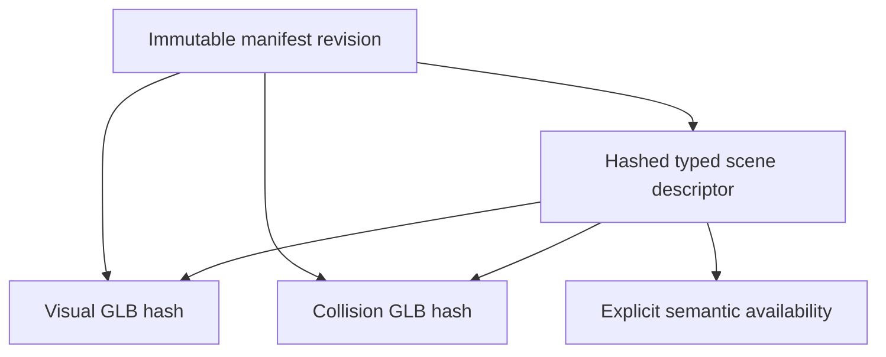

# Shared static collision and query contract

Status: proposal for owner review, not an implemented schema or gameplay change. Tracks [issue #70](https://github.com/djhenry/eqoxide_asset_server/issues/70), [asset-format project #51](https://github.com/djhenry/eqoxide_asset_server/issues/51) and [client project #1126](https://github.com/djhenry/eqoxide/issues/1126). This develops the approved unified-bake direction independently of the pending material/lighting choice.

## Recommendation and first milestone

Use a separate, source-independent collision GLB and a typed scene descriptor transported through the existing immutable manifest. Resolve source eligibility, placement ownership and coordinates in the bake. Runtime dispatch depends on the component role and declared query policy, never archive family, native flags, material transparency or mesh names.

The first implementation milestone should be **bounded static geometry inspection and segment queries**. It should establish a reusable writer, decoder, component association and truthful hit/miss/refusal interface. It must not replace production movement or navigation merely because triangles decode. Standing support, agent clearance, gameplay LOS, camera occlusion, liquids, climbing and changing actor collision need their own contracts and acceptance.

This is useful for both source families and authored enhancements. It preserves the route to full gameplay collision without calling an extracted candidate list a complete world. The alternative is to require the applicable movement, region and dynamic-entity work before any new collision inspection milestone; that is a substantially larger first delivery. Owner approval is required before implementing this proposal or changing established movement behavior.

## What the current paths establish

The legacy baker writes terrain collision into a named sentinel. The current client then appends transformed rendered objects, whose original collision eligibility is no longer available. That can lose invisible object solids and include visible passable surfaces. Existing water maps, name-derived climb volumes and runtime door visuals are separate; they do not establish a complete collision component.

The [EQG staging contract](eqg-collision-contract.md) exports default static triangle candidates. It remains an isolated source inspection format. Its coordinate convention differs from the [common geometry bridge](eqg-static-geometry.md): staged raw `(a,b,c)` becomes `(a,c,-b)`, while normalized common output becomes `(b,c,-a)`. Pairing those files unchanged would misalign components. The staging exporter also does not resolve all actor-level activation, dynamic exclusions or alternate query semantics.

Native investigation establishes that visual eligibility and default collision candidate eligibility differ. Query-selective filtering and directional face checks also exist. A single generic Solid flag or an unqualified double-sided ray cannot certify native floor, movement or LOS behavior. Unproved raw-bit meanings must remain unresolved producer diagnostics. Recorded candidate counts and bounds are extraction evidence, not server alignment or gameplay evidence.

The current common visual decoder accepts only its visual role/profile. It cannot decode collision-only POSITION/index data unchanged. The online loader still advertises the legacy reader contract. New capability metadata alone does not implement a collision decoder or gameplay integration.

## Normalized geometry and ownership

Propose a separate `StaticCollisionScene` input with indexed position pools, triangle primitives and reusable instances. It must not require fake UVs, visual normals, textures or materials. Reuse validated coordinate and instance helpers with the visual path; keep eligibility and validation specific to the collision component.

Input uses server geometry axes and counterclockwise oriented triangles. Output uses `eqoxide-static-y-up-v1`, unitScale 1, and `(sx,sy,sz) -> (sx,sz,-sy)`. This is the existing authoring convention, not a physical meter calibration. There is no actor-origin height correction. Source importers normalize all geometry and placement transforms before this boundary.

The EQG source-to-server X/Y reflection reverses triangle order once; the common server-to-asset mapping has positive determinant and preserves that normalized order. The legacy adapter must independently establish its own source-to-server mapping. Do not infer it from the EQG adapter or an old GLB. Position and transform tests must distinguish asymmetric axes and combined rotation, scale and translation.

Start with the same flat instance structure and proper rotation, translation and positive uniform-scale restrictions as common visuals. Unsupported shear, reflection or nonuniform scale must be baked into validated variants or refused. A triangle's geometric normal comes from its ordered transformed positions; smoothed visual normals and glTF material `doubleSided` are not query authority.

Terrain and each included static owner contribute exactly once. Keep stable importer/enhancement owner identities in the normalized data and a verified ownership/exclusion report. Local node/mesh indices are component references, not stable enhancement identities. Repeated placements may share geometry. Dynamic ownership must be resolved explicitly before claiming the corresponding static policy is complete; neither low altitude nor a filename alone establishes an exclusion.

Retain complete raw source geometry and flags upstream for later policy compilation. A filtered candidate artifact cannot reconstruct faces needed by a future query group. Required unresolved geometry or ownership blocks that requested bake profile; inspection omissions must be explicit.

## Proposed artifact profile

Reserve `static-collision-triangles-v1` as a required capability, with artifact schema 1, reader contract 2 and root role `collision`. Keep the existing `visual` meaning unchanged. Old reader-2 visual consumers reject the new role/capability; a new role-specific decoder must share safe GLB/accessor helpers rather than route through visual-material validation. Change the reader contract if an existing promise or coordinate meaning changes.

Nonempty collision payloads use embedded FLOAT VEC3 POSITION pools, unsigned indexed TRIANGLES and one BIN buffer. No external resources, skins, morphs, animation, material/texture inputs, unrelated attributes or hidden behavioral extensions are accepted in this initial profile. Validate every declared resource, including unused data; reject unsupported extras instead of treating them as collision instructions.

Propose a strict root `extras.eqoxideCollision` record containing version 1, scope `declared-static-triangle-candidates-v1`, availability `available` or `available-empty`, selected node references and a query-policy identifier. All nodes in the one flat scene must be selected exactly once. Display names such as `__collision__` have no role-selection authority. Exact field schemas and numeric-token rules are implementation-plan prerequisites, not finalized by this prose.

For a validated known-empty component, use an explicit JSON-only GLB with no geometry, accessors, buffers or BIN chunk, and an empty application selection. Core scene properties that cannot contain empty arrays are omitted. The collision decoder must support this case explicitly; the existing visual reader's JSON-plus-BIN/nonempty rule is not reused. No dummy degenerate triangle or zero-length core buffer is needed. Empty query geometry does not clear independent regions, climb volumes or dynamic data.

glTF supplies [geometry, transforms and application extras](https://registry.khronos.org/glTF/specs/2.0/glTF-2.0.html), not this game's query guarantees. General viewers may inspect geometry but cannot validate coverage or gameplay. The [Khronos extension registry](https://github.com/KhronosGroup/glTF/blob/main/extensions/README.md) lists collision shapes and rigid-body physics as review drafts when checked on 2026-10-12. This proposal does not depend on them or introduce a rigid-body simulator.

## Query policies and honest results

Define separate named version-1 inspection policies for front-face and double-sided segment intersections. Their eligibility is the encoded candidate dataset only. Choosing one must not claim that its results are gameplay LOS, native movement contacts or floor support. An importer records the selection policy in the input/policy revision and conversion report; raw native flags never reach runtime dispatch.

Reserve `static-segment-query-v1` separately from the geometry-decoding capability. The descriptor declares required operations as well as component availability, and required operation capabilities enter the manifest union. A geometry-only inspection snapshot may decode collision data while reporting segment queries unsupported; only an implemented query handler may advertise the operation. Neither capability grants walking or navigation.

Queries use finite endpoints in the component's decoded server geometry frame and return the nearest intersection on the endpoint-inclusive segment. Zero-length input is invalid for this initial segment operation; point/overlap queries are separate. Front-face policy requires motion toward the oriented geometric face; double-sided policy admits either orientation. Coplanar segments have no unique surface-crossing hit and return miss under this policy. Return geometric normal, front/back classification and stable component-local instance/primitive/triangle references. Shared-edge and equal-distance ties need a deterministic ordering.

Bind each request to an expected set/zone and immutable snapshot identity. Results echo that identity and the collision component digest; local geometry references are valid only within that snapshot. Reject stale or mismatched requests instead of returning a hit or miss from a different zone/revision. Production queries additionally require the active world/session generation and recheck it before publishing results, so a retained or in-flight old snapshot cannot satisfy a new zone session. Explicit inspection of an older snapshot is a separate, identity-qualified request, not automatic fallback.

Before implementing the query capability, freeze arithmetic, near-parallel/degenerate handling, boundary tolerance and tie rules with discriminating tests. Recommend widened arithmetic over validated f32 world positions; do not claim mathematical exactness or bit-identical native results. Arbitrary epsilon changes are policy changes, not invisible performance fixes.

Results distinguish hit, miss against the available dataset, unsupported operation/policy, invalid input, unavailable component and work-budget failure. A bounded miss is not a full-world clearance certificate. A malformed or marked-but-unsupported component never selects rendered geometry or a legacy fallback. Validated empty data can yield a geometric miss while movement and world readiness remain unavailable.

Future movement-blocking, support, LOS and camera groups require independently defined memberships and query policies. Partitioning primitives or adding buffered membership tables can express them without source switches. Unknown required groups/policies fail; a generic default must not alias an unimplemented mode. Preserve vertical faces even when a particular support query excludes them.

## Availability, coverage and gameplay activation

The scene descriptor distinguishes `not-extracted`, `unsupported`, `available` and `available-empty` for each semantic component. The last two reference validated bytes and a declared scope. Missing data is not known-empty. Failed validation is an activation error, not an availability value that silently permits gameplay.

Keep three separate facts: data decoded for a declared policy, producer coverage under that policy, and applicable runtime/server acceptance. An importer may report candidates without proving every static actor's native participation. It may not claim complete static coverage while required source roles or dynamic ownership are unresolved. A producer Boolean cannot self-certify walking/navigation readiness.

New inspection tools expose their supported geometry-query operation explicitly. Production integration must consume only explicit collision geometry, with no visual-object append or ladder-name inference. Movement activation additionally needs its support/clearance/controller policy, required region features, dynamic exclusion/overlay policy and independent server landmark/gameplay checks. The existing sampled movement rays are not an exact capsule sweep and must not be relabeled as one.

## Pairing through the existing manifest

Recommend a strict typed descriptor at the fixed package entrypoint `scene.json`, transported as an ordinary hashed manifest file under a new `static-scene-package-v1` capability. Its filename is an entrypoint convention; its typed contents establish component roles. Reuse manifest schema 1 identity machinery rather than append semantic fields that the current revision hash ignores.

The descriptor binds requested set/zone identity, schema, shared bake revision, coordinate/unit profile, component roles, availability/scope and exact relative file path/hash/size references. Available visual and collision components belong to the same immutable manifest revision. Their content hashes must match both descriptor and manifest entries; their inner header role, profile, bake revision and requirements must match the descriptor. Identical bounds or bakeRevision alone are insufficient.

The shared bake revision is derived from canonical source, enhancement and conversion-policy inputs before serialization. It is not a hash of its own GLBs or descriptor. Component hashes live in the descriptor/manifest; the descriptor's hash lives in the manifest. No inner artifact contains a self-referential digest or the eventual manifest revision.

Initially require a shared scene bake revision for available components. A visual-only policy change can require refreshing collision header identity even when its geometry is reusable; this is a deliberate simplicity cost. Future independent component reuse needs an explicit, reviewed association/provenance rule rather than relaxed equality.

Publisher validation checks descriptor membership and exact file identities, component/header agreement and the required-capability union, including the package capability. Required unsupported or absent components block the requested gameplay package. An inspection package can explicitly omit gameplay semantics without claiming those operations. Optional-component fallback, if added, must be specified; none is inferred here.

Upload and verify immutable files first, then expose one manifest latest pointer. Consumers validate the manifest, hashed descriptor and all required components into a temporary snapshot before activation; failure preserves the previous complete snapshot. Never combine independently downloaded latest visual/collision files. Existing cached/offline compatibility checks remain mandatory. Online reader advertisements advance only when the loader and all advertised operations actually work.

Preservation means retaining known-good bytes for retry or explicitly requested inspection. It does not permit the old snapshot to answer queries or grant readiness for the newly requested set/zone, revision or world generation. Activation records and query leases carry those identities together; replacement cannot rebind an in-flight local triangle reference to new component data. Failure of a new-zone load leaves that requested world's queries unavailable even if old-zone data remains cached.

## Volumes, enhancements and changing actors

Liquids, region classification, zone transitions and climb volumes are separate semantic components, not deductions from visible triangles. A common classifier can later retain bounded plane/tree data and explicit leaf types, avoiding a lossy conversion of irregular legacy regions into axis-aligned boxes. Authored boxes and other typed shapes can supplement either source family through generic capabilities. Normalization must transform plane equations and preserve boundary, overlap and precedence rules.

Large semantic tables may use GLB BIN/accessor-backed payloads with strict application metadata; small authored records may use a separately hashed typed component. The exact region/volume encoding needs its own reviewed contract. Keeping the package GLB-based does not require triangulating every semantic shape or inventing native meanings for opaque words. Unextracted or unsupported region data remains explicit.

Runtime doors, moving platforms and other changing actors need stable entity/asset bindings, local collision shapes and current transforms/state. A static bake cannot preserve future open/closed states. Their static exclusions and runtime overlay coverage must be verified together. No full dynamic physics or content editor is required by the initial geometry-inspection profile.

Enhanced legacy content can supply every implemented generic membership, volume or dynamic-binding feature through the same normalized inputs. Geometry/placement enhancements participate in bake identity and trigger revalidation of related collision/regions. Array position, display name and historical source family are not enhancement identity.

## Resource bounds and acceptance sequence

Do not inherit a visual writer's budget claim for collision. Bound GLB/JSON bytes, every resource collection and accessor-validation visit, retained position/index data, instances, expanded triangle count, transformed world evaluations and broad-phase construction before allocation/work. Bounds come from indexed transformed collision surfaces, not visual framing bounds or unused vertices. Grid cell products and triangle-cell assignments require checked arithmetic and explicit caps; another bounded acceleration structure is equally valid.

Report logical payload/work limits separately from allocator/process memory. Reused vertices and instances reduce authoritative payload, but do not make expanded query work free. For reference, f32 positions and worst-case u32 indices cost `12*V + 12*T` bytes before metadata; a duplicated position-only triangle soup costs 48 bytes per triangle. These are arithmetic, not measured load-time or RSS estimates. Runtime acceleration caches are disposable and keyed by verified component digest plus query policy/implementation version.

After owner review, implement in independently reviewable stages:

1. Freeze exact collision/descriptor schemas, query policies, budgets and empty representation; add source-independent positive/refusal fixtures.
2. Add positions-only writer and bounded role-specific decoder. Validate orientation, shared instances, invalid transforms, degenerate geometry, unused-resource limits and marked-unsupported refusal. No production activation.
3. Add the named segment-query inspection capability with discriminating edge/face/tie/budget tests. Author and independent reviewer each probe their own artifacts; remove deliberate faults and confirm assertion failures before exact restoration.
4. Add hashed descriptor/package validation and transactional activation with stale-component, mismatched-role/hash/revision, omitted-required-component and explicit-empty tests. Zone/revision/generation changes must refuse stale queries, including requests in flight; a failed new-zone load must never answer from the retained old zone. Compatibility-only/content changes remain distinct manifest identities.
5. Normalize both source adapters from retained raw data and verified owner/eligibility policy. Compare equivalent authored legacy/EQG outputs, including visible-passable and invisible-solid surfaces; regenerate staged EQG coordinates instead of relabeling them.
6. Specify semantic/dynamic and movement scopes, obtain approval for behavior changes, then independently verify representative zones against server landmarks and the declared operations before gameplay publication.

This proposal authorizes no decoder, query, package or movement behavior. A design-only review has no live-observable change to test. Later implementation needs meaningful fault injection and independent end-to-end checks at its actual acceptance boundary.
